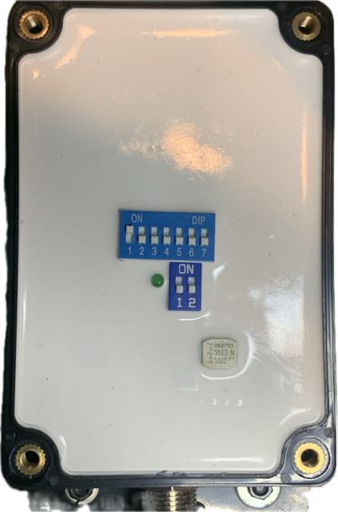

# CX5106 Engine Gateway — Configuration Guide

> ⚠️ **CORRECTION NOTICE — 2026-08-25 (BUG-81)**
>
> The original version of this guide described an 8-switch model that does not
> correspond to the actual device. Specifically: switches 1-2 (engine instance),
> 3-4 (RPM source type), 5-6 (cylinder count), 7 (stroke), 8 (gear ratio) do not
> exist as separate fields. The CX5106 has **two physically separate switch blocks**:
> **Block A (7 positions)** encodes ONE binary value (the RPM speed ratio) and
> **Block B (2 positions)** encodes tank-sender standard and port/starboard.
>
> The wizard's Step 5 (`setup.html`) implements the wrong model faithfully — it
> was coded from this guide. **This guide is corrected first** so the implementation
> fix has a correct specification to work from.
>
> The superseded original is preserved at the end of this file. Do not delete it:
> it is the record of what the wizard currently implements, and reviewers need it
> to understand what the Step 2 replacements are undoing.
>
> Authority: `docs/CX5106_DIP_SWITCH.md` (S132 derivation from the leaflet).
> Hardware verified from: `assets/images/cx5106_10125.png` (direct photo).

---

## Overview

The CX5106 is an analog-to-NMEA2000 engine gateway that converts analog engine signals
into NMEA2000 PGNs for display on marine chartplotters and multi-function displays.

**Hardware:**
- Raspberry Pi 4B
- PiCAN-M HAT
- CX5106 Engine Gateway (manufacturer: Matsutec — not Actisense)
- NMEA2000 backbone

---

## Part 1: DIP Switch Configuration Logic (CORRECTED)

The CX5106 has **two physically separate switch blocks** — they are not one row of eight.

### Physical Layout

**Visual Reference:**



*Photo showing the actual CX5106 DIP switch blocks. Block A (7 positions, top) and
Block B (2 positions, lower right) are separate components on the face of the unit
with the lid removed.*

The switch blocks are on the **face** of the CX5106 unit (lid removed to access), not the side.

**Block A** — 7 positions, labeled `1 2 3 4 5 6 7`, below an `ON` legend.
These seven positions together encode **one binary number** — the RPM speed ratio.
They are NOT seven independent configuration fields.

**Block B** — 2 positions, physically separate, lower right of Block A, with a green LED.
Each position IS an independent field (tank sender standard; port/starboard).

### Block A: RPM Speed Ratio Encoding

Block A is a 7-bit binary number.

```
ratio = 1 + (sw1 × 1) + (sw2 × 2) + (sw3 × 4) + (sw4 × 8)
           + (sw5 × 16) + (sw6 × 32) + (sw7 × 64)
```

sw1 is the LSB. All seven switches OFF → ratio = 1. sw1 + sw2 ON → ratio = 4.

**Source:** CX5106 leaflet sheet D2026-B section 6 (transcribed in `docs/CX5106_DIP_SWITCH.md`).

### Engine-to-Ratio Lookup

The correct ratio depends on the engine family. **Do not use one table for all families.**

#### Inboard Gasoline (keyed on cylinders, 4-cycle)

| Cylinders | Ratio | Block A setting |
|-----------|-------|-----------------|
| 4         | 2     | sw1 ON; sw2-7 OFF |
| 6         | 3     | sw1 + sw2 ON; sw3-7 OFF |
| **8**     | **4** | **sw1 + sw2 ON; sw3-7 OFF** |
| 10        | 5     | sw1 + sw3 ON; sw2,sw4-7 OFF |
| 12        | 6     | sw2 + sw3 ON; sw1,sw4-7 OFF |

The Mercruiser 454 MPI (8-cylinder, 4-cycle inboard gasoline) → **ratio 4 → sw1 ON, sw2 ON**.

#### Outboard (keyed on POLE count — not cylinders)

| Poles | Ratio | Block A setting |
|-------|-------|-----------------|
| 4     | 2     | sw1 ON |
| 6     | 3     | sw1 + sw2 ON |
| 8     | 4     | sw1 + sw2 ON |
| 10    | 5     | sw1 + sw3 ON |
| 12    | 6     | sw2 + sw3 ON |

⚠ **Pole count is not the same as cylinder count.** It is typically found in the service manual,
not the owner's manual.

#### Diesel

The leaflet's entire rule is: **Speed Ratio = Gear Number**. "Gear Number" is not defined
anywhere in the leaflet. If the owner has the Gear Number, enter it directly as the ratio.
If unknown, use the empirical method (see Troubleshooting below).

### Block B: Independent Fields

| Switch | OFF | ON |
|--------|-----|----|
| B sw1  | European (0-190Ω senders) | North American (240-33Ω senders) |
| B sw2  | Port / Single engine | Starboard engine |

These two mappings are correct and unchanged from the original guide.

---

## Part 2: Required Wizard Questions (CORRECTED)

### **Question 1: Number of Engines** *(unchanged)*
Maps to Block B sw2.

### **Question 2: Engine Position** *(unchanged — if multiple engines)*
Maps to Block B sw2 (Port = OFF, Starboard = ON).

### **Question 3: RPM Signal Source** *(REMOVED — no such field on Block A)*

> **Why removed:** The original guide mapped Q3 to "switches 3-4: RPM source type."
> Block A has no such field. The only input is the ratio. **The RPM signal source is
> determined by physical wiring (which terminal the CX5106 is tapped to), not a DIP switch.**
> Remove this question from the wizard.

### **Question 4 (NEW): Engine Family**
**Question**: "What type of engine does this CX5106 monitor?"

**Options**:
- Inboard gasoline
- Outboard
- Diesel
- I don't know → route to empirical method

**Maps to**: Block A (determines which lookup table to use)

**Why the family matters**: The ratio lookup differs by family. A cylinder-keyed map works for
inboard gasoline and gives wrong results for every outboard and diesel.

### **Question 5 (conditional): Engine Details**

**If inboard gasoline**: "How many cylinders does your engine have?"
- Options: 4, 6, 8, 10, 12
- Maps to: ratio via the inboard-gasoline table

**If outboard**: "How many poles does your outboard engine have?"
- Help text: "Pole count is in the service manual, not the owner's manual."
- If unknown → route to empirical method

**If diesel**: "Do you know your engine's Gear Number?"
- Help text: "The CX5106 leaflet instructs Speed Ratio = Gear Number. The term 'Gear Number'
  is not defined in the leaflet. If you do not know it, use the empirical method."
- If unknown → route to empirical method

### **Question 6 (REMOVED): Stroke Type** *(no such field on Block A)*

> **Why removed:** SW7 (stroke type) does not exist. Removed.

### **Question 7: Tank Sensor Standard** *(unchanged — Block B sw1)*

Maps to Block B sw1. Unchanged from original:
- North America / US / Canada (240-33Ω) → ON
- Europe / International (0-190Ω) → OFF
- If inverted readings → toggle this switch

### **Question 8: Engine Position Designation** *(unchanged — Block B sw2)*

Maps to Block B sw2. Unchanged from original:
- Single / Port → OFF
- Starboard → ON

---

## Part 3: Wizard Output

### Correct Block A diagram (7 switches)

After determining ratio, encode to Block A bits and display:

```
Block A — RPM Speed Ratio 4  (8-cyl inboard gasoline)
┌───┬───┬───┬───┬───┬───┬───┐
│ 1 │ 2 │ 3 │ 4 │ 5 │ 6 │ 7 │
├───┼───┼───┼───┼───┼───┼───┤
│ ↑ │ ↑ │ ↓ │ ↓ │ ↓ │ ↓ │ ↓ │
└───┴───┴───┴───┴───┴───┴───┘
   ON  ON OFF OFF OFF OFF OFF

Block B — Tank Sender / Engine Position
┌───┬───┐
│"1"│"2"│
├───┼───┤
│ ↑ │ ↓ │   (North American senders, Port/Single)
└───┴───┘
```

### When ratio is unknown (outboard / diesel / "I don't know")

Display the empirical method instead of a switch diagram. **Do not emit a default.**
A silent default on a hardware configuration screen is worse than an error message.

```
Cannot automatically determine the ratio for your engine type.
Use the empirical method (see Troubleshooting → Empirical Ratio Method).
Start at ratio 2 and adjust until the displayed RPM matches your analogue tachometer.
```

---

## Part 4: Troubleshooting

### Empirical Ratio Method

If the correct ratio cannot be computed from the lookup tables:

1. Run the engine at a steady, known RPM (verify on the analogue tachometer).
2. Start with ratio 2 (Block A: sw1 ON, all others OFF).
3. Compare displayed RPM to tachometer.
4. If displayed is double tachometer → ratio is too high; move down.
   If displayed is half tachometer → ratio is too low; move up.
5. **Try both directions** — the leaflet does not document which direction scales RPM up vs down.
6. Confirm at idle **and** cruise speed.

**Key diagnostic:** A ratio error is a *constant factor*. The RPM is wrong by the same proportion
at every engine speed. If the error *changes* with RPM, the ratio is not the problem — the
signal source wiring is.

### RPM Reading is Zero

1. Verify physical wiring (correct terminal on engine).
2. Power cycle the CX5106 (off 10 seconds, then on).
3. Check NMEA2000 backbone termination.

### Tank Readings are Inverted (empty shows full)

Toggle Block B sw1 (tank sender standard is set to the wrong region).

---

## Part 5: Configuration Storage

```json
{
  "gateway": {
    "model": "CX5106",
    "manufacturer": "Matsutec",
    "block_a": {
      "ratio": 4,
      "sw1": "ON", "sw2": "ON", "sw3": "OFF", "sw4": "OFF",
      "sw5": "OFF", "sw6": "OFF", "sw7": "OFF"
    },
    "block_b": {
      "sw1": "ON",
      "sw2": "OFF"
    },
    "rpm_ratio": 4,
    "tank_sensor_standard": "north_american_240_33",
    "engine_position": "port"
  }
}
```

---

---
---

# ⛔ SUPERSEDED ORIGINAL — preserved for Step 2 reference (BUG-81)

> **Do not delete this section.** It is the record of what `setup.html`'s Step 5
> currently implements. Reviewers need it during Step 2 (BUG-81-WIZARD.md §3)
> to understand the exact replacements: `buildDIPRow1`, `cylinderMap`,
> `buildRow1Key`, `buildWhyText`, and the Actisense attribution.
>
> Once Step 2 is complete and tested, this section may be removed.

---

## [SUPERSEDED] Part 1: DIP Switch Configuration Logic

The CX5106 has **8 DIP switches** that control how it operates and what PGNs it outputs.

### [SUPERSEDED] DIP Switch Functions

#### **Switches 1-2: Engine Instance Selection**

| SW1 | SW2 | Engine Instance |
|-----|-----|-----------------|
| OFF | OFF | Instance 0 (Primary/Single Engine) |
| ON  | OFF | Instance 1 (Port Engine) |
| OFF | ON  | Instance 2 (Starboard Engine) |
| ON  | ON  | Instance 3 (Center/Auxiliary) |

#### **Switches 3-4: RPM Source Configuration**

| SW3 | SW4 | RPM Source Type |
|-----|-----|-----------------|
| OFF | OFF | Alternator W-Terminal |
| ON  | OFF | Ignition Coil |
| OFF | ON  | Magnetic Pickup |
| ON  | ON  | ECU Digital Output |

#### **Switches 5-6: Number of Cylinders**

| SW5 | SW6 | Cylinders |
|-----|-----|-----------|
| OFF | OFF | 4 cylinders |
| ON  | OFF | 6 cylinders |
| OFF | ON  | 8 cylinders |
| ON  | ON  | 3 cylinders |

#### **Switch 7: Engine Stroke Type**

| SW7 | Engine Type |
|-----|-------------|
| OFF | 4-Stroke |
| ON  | 2-Stroke |

#### **Switch 8: Gear Ratio**

| SW8 | Gear Ratio |
|-----|------------|
| OFF | 1:1 (Direct Drive) |
| ON  | 2:1 (Reduction Gear) |

---

## [SUPERSEDED] Part 2: Required Wizard Questions

Q1 Number of Engines → SW1/SW2 (Instance)
Q2 Engine Position → SW1/SW2 (Instance)
Q3 RPM Signal Source → SW3/SW4
Q4 Number of Cylinders → SW5/SW6
Q5 Engine Stroke Type → SW7
Q6 Gear Ratio → SW8
Q7 Tank Sensor Standard → Second Row SW1 (correct)
Q8 Engine Position → Second Row SW2 (correct)

The wizard's `buildDIPRow1()`, `cylinderMap`, `buildRow1Key()`, and `buildWhyText()`
implement Q1–Q6 above. The code is not independently wrong — it correctly implements
this specification. **This specification is wrong.**

---

*Guide corrected 2026-08-25 — BUG-81 Step 0.*
*Authority: `docs/CX5106_DIP_SWITCH.md` + direct photo analysis (`assets/images/cx5106_10125.png`).*
